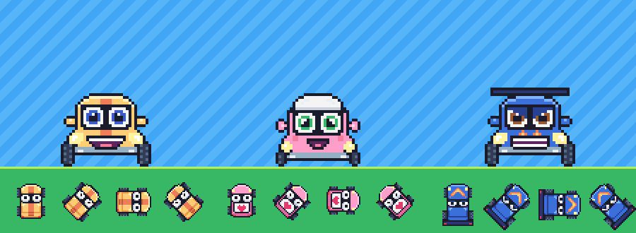
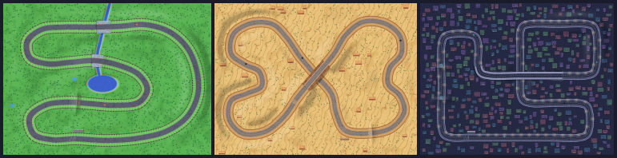

# Tiny Turbo GP

A cute, pixel-art, top-down 2D racing game. The racers are little Q-style
(chibi) cars with big eyes on the windshield and a grin on the bumper. You pick
one of three cars and one of three tracks, then race three laps against
computer rivals over hills, jumps and bridges.





Built with **[Phaser 4](https://phaser.io)** (MIT), TypeScript and Vite, plus
**[three.js](https://threejs.org)** (MIT) for the 3D chase view. Every sprite,
voxel model, track and sound is generated from code at start-up: the repository
contains no image, model or audio files, so the art is easy to change.

## Play

Requires Node.js 20.19+ (tested on Node 24).

```bash
npm install
```

```bash
npm run dev
```

Open http://localhost:5173 to play, or http://localhost:5173/garage.html for
the car preview page.

```bash
npm run build
```

`npm run build` writes a static site to `dist/` that any web server can host
(itch.io, GitHub Pages, Netlify...). Use `npm run preview` to test that build
locally.

## Controls

| Action            | Keyboard              | Gamepad           | Touch screen     |
| ----------------- | --------------------- | ----------------- | ---------------- |
| Accelerate        | Up / W / X            | A or right trigger| GAS button       |
| Brake / reverse   | Down / S / Z          | B or left trigger | BRAKE button     |
| Steer             | Left/Right or A/D     | Left stick / d-pad| arrow buttons    |
| Drift             | Space / Shift         | RB                | DRIFT button     |
| Fire nitro        | C                     | X                 | NITRO button     |
| Fire your missile | F, or click the rocket box | LB         | MISSILE button, or tap the rocket box |
| Put up your shield | G, or click the bubble box | D-pad up  | SHIELD button, or tap the bubble box |
| Switch view       | V, or click VIEW      | Y                 | VIEW button      |
| Back onto the track | R, or click R       | Back / Select     | R button         |
| Pause             | Esc / P               | Start             | -                |
| Results now (after the finish) | Enter / Space | A          | tap the screen   |
| Sound on/off      | M                     | -                 | -                |

WASD and the arrow keys do exactly the same thing everywhere, including in the
menus, so use whichever hand position you like.

**Drifting and nitro (Need for Speed style).** Going into a bend, press Space
while steering: the tail kicks out and the car slides sideways with its nose
turned into the bend, trailing tyre smoke. Then you steer the slide:

- **Steer into the bend** for a wide slide that turns you tightly.
- **Let go of the arrow but keep Space held** for a medium slide through a
  long bend.
- **Steer the other way** to straighten up and leave the drift (letting go
  of everything lets it fade out on its own).

Drifting earns points, more for faster and wider slides. Start the next drift
within 2 seconds to chain a combo (up to ×5); the combo is banked a moment
after your last drift, but hitting a wall or a car hard loses it. The points
fill the **NITRO** gauge above your speed. When it's full it flashes
**C: NITRO!**: press **C** for a 2.6-second burst of speed (+40% top speed).
Nitro only pushes while you're on the gas, so you can still brake for a
corner. Wide slides cost some speed, but drifting is the fastest way through
tight hairpins. Rival cars drift and use nitro too. The orange (or cyan, at
night) chevron pads on the road give a short boost.

**Hills, jumps and bridges.** The tracks climb and dip. Running downhill
speeds you up, even past your usual top speed for a moment; climbing slows
you a little. Yellow chevrons on the road (cyan at night) lead up to a jump:
take it fast and you fly. You can turn your nose a little in the air to
line up the landing, and landings never cost speed. A jump of more than about
a third of a second scores **AIR!** points straight into your nitro gauge.
Bridges carry the road over a river, or over another part of the track where
it crosses itself. While you drive under a bridge it turns see-through, so it
never hides your car.

**Two camera views.** The **TOP** view looks straight down with north up, like
a map. The **CHASE** view is a 3D view from just behind and above your car,
looking down the road to the horizon, like classic kart racers. The cars,
trees, barriers, buildings, mesas and grandstands are all little voxel models,
with real shadows, and at night the city's windows and neon glow. When the
road bends, the horizon slides sideways the way it does when you turn your
head; the picture never spins. The camera follows the direction your car is
travelling on a soft spring, so steering taps and drifts don't jerk the view,
and a rival that gets between the camera and your car turns see-through. Over
hills the camera glides up and down with the road but never tilts, and a
jump lifts your car, not the camera.
Switch any time during a race with the VIEW button under your position, the V
key, gamepad Y, or the pause menu. The game remembers your choice.

**Steering** winds up over about 0.2 s and straightens out twice as fast, so a
quick tap is a small correction and holding the key turns properly. Steering
gets gentler at high speed; for the tightest bends, brake a little or drift.

**Going off the road is forgiving.** Grass and sand slow you down gently, to
75% of top speed on the meadow's grass, 70% in the canyon's slippery sand and
85% on the city's pavement, so a wheel on the grass costs a little time, not
the race. A drift that runs wide straightens out on the grass instead of
snapping off, and picks up again when you're back on the road (no drift points
are scored on the grass). Hitting a barrier never stops you dead: the car
glances off and its nose swings round to run along the wall. A scrape barely
slows you, a hard hit costs more (a head-on one about 60% of your speed), and
the slowdown comes on over a moment rather than all at once.

**Coins, items and hazards.** Every track has things on the road, inspired
by the classic kart and top-down racers:

- **Gold coins** sit in lines along the road. Each one you carry adds 1% to
  your top speed, up to 10 coins (+10%). The counter is next to the item boxes.
  Getting hit by a missile spills 3 of them, and knocking over an obstacle
  spills 1. Collected coins come back after a few seconds.
- **Item pickups** float in rows across the road. Drive through one to take
  it: a **missile** (a little rocket) or a **shield** (a blue bubble). Each
  has its own box at the top left, so you can carry a missile and a shield
  together and use them separately: **F** fires the missile and **G** puts
  up the shield (or click their boxes; gamepad LB and d-pad up; the MISSILE
  and SHIELD buttons). An empty box shows a faint outline. With a missile
  already in hand you drive through missile pickups, leaving them for the
  others, but still grab a shield, and the other way round.
- **Missiles** fly along the road to a random car ahead of you in the race and
  stop it for **3 seconds**, with stars spinning over its head. If you're in
  the lead there's nothing to aim at: the rocket in the box is dimmed and
  stays there until a car gets ahead. Rival cars pick up and fire missiles
  too: **MISSILE!** flashes and beeps while one is coming for you, and the
  minimap shows it as a blinking dot. After a hit, a car blinks for 2 seconds
  and can't be stopped again, and only one missile chases a car at a time.
- **Shields** put a bubble round your car for 6 seconds. It stops one missile
  (then pops) and lets you plough through obstacles without slowing down.
  While a bubble is up, a spare shield waits in its box (dimmed) instead of
  being wasted; G works again once the bubble is gone. **MISSILE!** tells you
  which key raises your shield when you have one. Rivals put theirs up a few
  seconds after picking them up, so watch for the bubble before you fire.
- **Obstacles** stand on the road: hay bales in the meadow, kegs in the
  canyon, traffic cones in the city. Knocking one over costs about 30% of your
  speed, a little at once and the rest over a moment. It flies off and comes
  back later.
- **Puddles** of mud (meadow) or oil (canyon, city) make the tyres slip. Mud
  also slows you; oil hardly slows you but you'll slide, so steer gently.

A missile hit never spins your car or the camera: the car simply skids to a
stop where it points. You can't use R to escape a hit. Rivals on **Easy**
never aim missiles at you, and on **Medium** they're slower and less keen to.

**Lost? Press R.** If you spin round, drive the wrong way or get stuck, press
**R** (or click the **R** button next to VIEW, or gamepad Back) to pop back
onto the road at the point of the lap you'd reached, facing the right way and
already rolling. The car lands in the middle of the road, or beside or just
behind another car if one is there. "WRONG WAY!" and being stuck on the grass
both show a reminder.

**Difficulty.** On the track screen, pick **EASY**, **MEDIUM** or **HARD** with
Up/Down (or click one). The game remembers your choice; a new player starts on
Medium.

| Level  | Rival speed | Rivals' nitro charging | Your nitro charging | Rivals' missiles at you |
| ------ | ----------- | ---------------------- | ------------------- | ----------------------- |
| Easy   | 86%         | half as fast           | 2× as fast          | never                   |
| Medium | 93%         | 3/4 as fast            | 1.5× as fast        | a third as often, slower to fire |
| Hard   | full        | normal                 | normal              | like at any other car   |

Best times are kept separately for each level. Times set on the first,
smaller versions of the tracks are not shown any more.

## What is in version 1

- **3 cars:** Zippy (all-rounder), Momo (light and nimble), Rumble (heavy and
  fast). Each has a top-down race sprite whose eyes follow your steering, plus
  a blinking menu portrait.
- **3 tracks**, each lap 30 to 40 seconds:
  - **Sunny Meadow** (easy): rolling hills, a river crossed by two stone
    bridges, a long downhill and a small jump.
  - **Dusty Canyon** (medium, slippery sand): a figure of eight that crosses
    itself on a timber trestle, then drops into the canyon; two jumps.
  - **Neon City** (hard, at night with street lights): a flyover above the
    avenues and two steep hills in a row that send you flying.
- **Paint shop:** draw your own car pixel by pixel, give it a name and stats,
  and race it. Cars are saved in the browser, and the 3D view turns them into
  voxel cars automatically.
- 4-car races over 3 laps. With a team car you race the two other team cars
  and a repainted rival twin of your car (Kiwi, Lilac or Ruby); with your own
  car you race all three team cars.
- Need for Speed-style drifting: steer the slide, chain drifts into combos
  for points, fill the nitro gauge and fire it when you choose.
- AI drivers that brake for corners, take the inside line, dodge traffic,
  drift through tight bends and use nitro on the straights.
- Hills that speed you up downhill, jumps that score nitro, and bridges
  over rivers and over the track itself.
- Gold coins that raise your top speed, missile and shield pickups, and
  knock-over obstacles and slippery puddles on every track.
- Countdown, lap and position HUD, minimap, wrong-way warning, R to reset
  onto the track, pause menu, results podium, and best race and lap times
  saved in the browser.
- Synthesised chiptune music and sound effects, with a song for each track:
  bouncy for the meadow, a western gallop for the canyon, night-time synthwave
  for the city.
- Keyboard, gamepad and touch controls.

## Design your own car

### In the game: the paint shop

On **Choose your racer**, pick the **New car** card at the end of the row. To
edit one of your cars, press **E** on it (or click its EDIT tag). Pressing E on
a team car starts a new car from a copy of it.

- Draw on the **top view** (the race sprite, nose up) and the **face** (the
  menu portrait). Mirror is on by default, so both sides paint together.
- Pick a **paint pot** (body, stripe, eyes, tyres...) and refill it from the
  colour grid. Body and stripe colours bring their own light and shadow shades.
- Name the car, then share out **14 stat points** between speed, acceleration,
  handling and weight.
- **Save** keeps the car in this browser (up to 12 cars). **Race!** saves it
  and takes you to the track choice.
- **Copy code** puts the car on the clipboard as a ready-made entry for
  `src/art/cars.ts`, so you can make it a permanent team car.
- **In 3D,** the top view becomes the car's shape: the rows with the eyes
  (`W`, `p`) start a tall cabin, the bonnet in front and the deck behind are
  lower, tyre pixels (`t`, `T`) become spinning wheels, and dark trim (`s`)
  drawn across the back becomes a wing.

| Paint shop key | Action |
| -------------- | ------ |
| Left mouse / right mouse | paint / erase |
| P, E, F, I | pen, eraser, fill, pick colour from the drawing |
| X | mirror on/off |
| Z / Y (or Ctrl+Z / Ctrl+Y) | undo / redo |
| Tab | switch between top view and face |
| N | rename (the first key typed replaces the old name) |
| Esc | back to the car list (asks before throwing away changes) |

The paint shop works with a mouse or touch screen. On a touch screen, use the
**?** button next to the name for a random name. A gamepad can't draw, but its
B button leaves the paint shop.

### In code

All team cars live in [`src/art/cars.ts`](src/art/cars.ts) as ASCII pixel art:
one character is one pixel, and the colour legend sits at the top of the file.

```ts
top: [
  '......kkkkkkkk......',   // k = outline, B = body, a = stripe
  '....kkhhhhhhhhkk....',   // W = eye white, p = pupil
  ...
```

1. Run `npm run dev` and open `/garage.html`.
2. Edit a drawing, colour or stat in `src/art/cars.ts` and save. The garage
   reloads and shows the portrait, the blink frame, the top view and the
   spinning in-race sprite. It also lists your paint-shop cars, each with a
   button that copies its code.
3. Start a race to drive it.

The `top` drawing is the race sprite, nose pointing up. The game builds 32
rotations from it automatically and slides the pupils (`p`) left or right when
you steer. The `front` drawing is the menu portrait; its eyes (`W`/`w`/`i`/`p`)
blink on their own. Changing `palette` repaints a car, and `alt.palette` sets
the rival twin's paint. To add more cars, append entries to `CAR_DESIGNS`;
the car list scrolls, so any number fits, and races always field four cars.

## Add or reshape a track

Tracks are defined in [`src/tracks/tracks.ts`](src/tracks/tracks.ts) as a
handful of control points on a smooth closed loop. The start line sits on the
first point. Asphalt, curbs (on bends only), run-off, barriers, scenery and the
grandstand are all painted automatically from that loop, in the theme you pick
(`meadow`, `canyon` or `city`; see `src/tracks/themes.ts`).

The loop may cross itself, as long as one side goes over the other on a
bridge. Three more lists shape the ground:

- `elevation`: the road's height in px at points along the lap,
  `[at, height]` (0..1 along the lap). The heights are joined by smooth
  curves that never overshoot, so two equal heights in a row make a level
  stretch. Keep slopes gentle (about 1 in 10 at most). A drop of 20 to 50 px
  makes a downhill you can feel.
- `jumps`: kickers built into the road, `{ at, h, up, down }`: it rises `h`
  px over `up` px to a sharp lip at `at`, then falls away over `down` px.
  Put them on a straight, with a straight run of 200 px or more after.
- `bridges`: stretches of road carried on a deck, `[from, to]` along the lap.
  Where the loop crosses itself, put a bridge on the higher side, about 30 px
  or more above the road beneath, reaching past that road on both sides.
- `river` (optional): a course of points, a width and an optional lake at
  its end. Bridges carry the road over it.

The ground around the road (hillsides, embankments, the river's channel) and
the bridges' piers are built automatically.

After editing, run:

```bash
npm run sim
```

This first checks each layout and lists any problems: a crossing without a
bridge, a bridge too low or too short, an item on a bridge or a jump's ramp,
a jump that lands in a bend, a river meeting the road away from a bridge.
Then it simulates full races with computer drivers on every track and car in
a few seconds. If everybody finishes with few wall hits, the track is
drivable. `npm run sim -- easy` (or `medium`) races on an easier level. Under
each race it also counts the missiles fired (and how many hit or were
blocked), how often "you" (a perfect computer driver) were hit, the obstacles
knocked over, the coins collected, and your jumps and their airtime.

Each track also lists what's on its road, using the same `at` (0..1 along the
lap) and `lateral` (px off the centreline, positive = right) as boost pads:

- `coins`: lines of gold coins, `{ at, lateral, count }`, 14 px apart.
- `itemRows`: where rows of three item pickups cross the road.
- `obstacles`: one hay bale, keg or traffic cone each (by theme).
- `puddles`: mud or oil, `{ at, lateral, r }` with `r` in px.

The computer drivers steer round obstacles and puddles on their own, but keep
them on the road and a little apart so there's always a way past. Keep all
of these off bridges and jump ramps (the checks above will tell you).

## Project layout

```
src/
  main.ts              Phaser game config (480x270, pixel art, scaled to fit)
  config.ts            resolution, UI colours, time formatting
  garage.ts            the /garage.html car preview page
  art/
    cars.ts            ✏️ car designs (ASCII pixel art, colours, stats)
    raster.ts          tiny software canvas, Scale2x, RotSprite-style rotation
    sprites.ts         builds rotated car sheets, blinking portraits, UI icons
    font.ts            hand-made 7px pixel font
    voxel.ts           voxel grids and the greedy mesher
    car3d.ts           voxel cars built from the top-view drawings
    props3d.ts         voxel trees, cacti, rocks, lamp posts...
    itemArt.ts         coins, rockets, bubbles, obstacles (sprites and voxels)
  tracks/
    tracks.ts          ✏️ track layouts, hills, jumps, bridges, rivers
    themes.ts          colours, barrier styles and off-road grip per theme
    geometry.ts        spline, height profile, bridge decks, "where am I on the track?"
    terrain.ts         the ground's heights around the road, the river
    check.ts           layout checks for `npm run sim`
    paint.ts           paints the track texture, bridge decks and scenery
    minimap.ts         track outlines for menus and the HUD
    sky.ts             360-degree sky and skyline for the chase view
    scenery3d.ts       barriers, railings, buildings, mesas, grandstands, gantry in 3D
    perspective.ts     software 3D ground (fallback chase view)
    trackCache.ts      keeps the current track ready for quick restarts
  game/
    physics.ts         arcade car handling, drifting, slopes, flying, collisions
    ai.ts              computer drivers
    race.ts            laps, positions, walls, jumps and landings, boost pads
    items.ts           coins, missiles and shields, obstacles, puddles
    difficulty.ts      ✏️ the Easy / Medium / Hard settings
    chaseRig.ts        the chase camera's lens and follow spring
    input.ts           keyboard / gamepad / touch controls
    audio.ts           WebAudio synth: engine, effects, chiptune music
    save.ts            records and settings in localStorage
    customCars.ts      paint-shop cars: storage, validation, export as code
    pixelDoc.ts        editable pixel drawing with undo, mirror and fill
  scenes/              Boot, Title, CarSelect, TrackSelect, Race, Results,
                       PaintShop; ChaseView3D + World3D (the three.js chase
                       view), ChaseView (its software fallback); ItemSprites
                       and Items3D draw the items in each view
  ui/                  pixel labels, panels, buttons, dialogs, menu input
scripts/simulate.ts    headless race simulation (npm run sim)
docs/DESIGN.md         game design document
```

The `art`, `tracks` and `game` folders (apart from `input.ts`, `audio.ts` and
`trackCache.ts`) are plain TypeScript with no Phaser dependency, so Node can
run them directly.
`npm run sim` uses that.

See [docs/DESIGN.md](docs/DESIGN.md) for the design rationale, tuning notes and
ideas for the next version.
